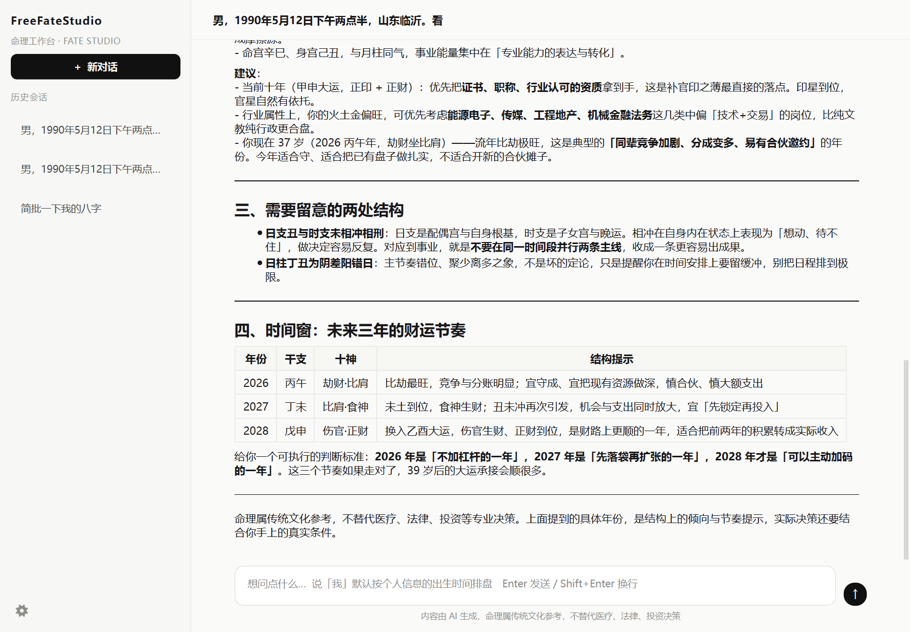
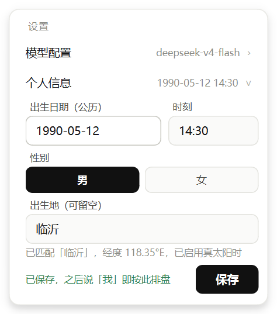

<p align="center">
  
</p>

# FreeFateStudio · 命理工作台

纯 Python 桌面端的东方命理助手。界面是 PySide6，模型服务在本机进程内跑 FastAPI + LangGraph，
所有排盘、起卦、黄历计算都在本地完成，基于<a href="https://6tail.cn/calendar/api.html">Lunar</a>计算，只有大模型推理走 DeepSeek API。



## 架构

```
PySide6 桌面客户端
      ↓ HTTP + SSE（127.0.0.1:8765，端口被占用时自动换）
FastAPI 本地服务
      ↓
LangGraph ReAct Agent（llm_node / tool_node / router 手写循环）
      ↓
命理工具层
  ├─ get_bazi_chart   八字排盘（lunar_python + 42 种神煞/十二长生/月令加权/刑冲合害/真太阳时）
  ├─ cast_liuyao      六爻起卦（金钱卦 / 时间卦，纳甲装卦、六亲六神世应）
  ├─ query_almanac    黄历查询（宜忌、冲煞、值神、吉神凶煞、时辰吉凶）
  ├─ explain_term     术语解释（本地词典，80+ 条）
  └─ get_today_date   相对时间换算
      ↓
本地存储
  ├─ %LOCALAPPDATA%\FreeFateStudio\fate.db        会话、消息与个人信息（用户可见）
  └─ %LOCALAPPDATA%\FreeFateStudio\checkpoint.db  LangGraph 图状态（多轮上下文）
```

## 运行

```bash
#(python13环境)
pip install -r requirements.txt
python run.py
```

首次运行前，在项目根目录创建 `.env`（也可以启动后在界面里填，见下节）：

```
DEEPSEEK_API_KEY=sk-xxxx
FATE_MODEL=deepseek-v4-flash
FATE_THINKING=0
```

## 模型配置

> 目前仅适配了Deepseek

左下角的齿轮 → 「模型配置」→ 填模型名称与 API Key → 保存。

保存不是改内存变量，而是**直接改写 `.env`**：`PUT /api/settings` 会把
`FATE_MODEL` / `DEEPSEEK_API_KEY` 写回文件（保留其它键与注释），同时更新进程环境变量并递增
配置版本号，`get_graph()` 检测到版本变化后重建模型与图（checkpointer 连接复用，
历史上下文不丢），所以**下一句话就生效，不用重启**。

写入位置按优先级选取：

1. `%LOCALAPPDATA%\FreeFateStudio\.env`（若已存在，视为用户覆盖值，优先级最高）
2. exe / 项目根目录的 `.env`（可写时直接改它，用户看得见）
3. 安装目录不可写（例如装在 `Program Files`）时自动回落到 1

面板里 API Key 留空表示"不修改已保存的 Key"，输入框只显示掩码（`sk-abc…1a2b`），不回显明文。

## 个人信息（「我」的长期记忆）

齿轮 → 「个人信息」：填一次出生日期、出生时刻（精确到分钟）、性别、出生地（可留空）。



保存后写入 `fate.db` 的 `profile` 表（固定单行 `id=1`，程序里只有一个"我"），此后：

- 用户说「我今年的运势」「我的八字」，Agent 直接按这份档案排盘，不再追问出生时间与性别；
- 档案段落每轮现拼进 system prompt，改完**下一句话就生效**，不重建模型、不清上下文；
- 用户给出的是别人的出生信息时照常排盘，不影响档案。

出生地决定是否启用真太阳时，规则是"要么用准确经度，要么干脆不用"：

| 填写情况 | 处理 |
|---|---|
| 留空 / 全是空格 | 不启用，`birth_city` 不传给排盘工具 |
| 地名能匹配经度表（含"山东临沂""临沂市"这类模糊匹配） | 启用，按经度 + 均时差校正，时柱可能因此变化 |
| 地名查不到（如"瓦坎达"） | 原样保留输入，但**不启用**真太阳时，面板提示"未收录" |

校验在服务端（`app/profile.py`）完成：日期必须是真实存在的公历日期、不早于 1900 年、不晚于今天；
时刻 0-23:59；性别必须是男或女（大运顺逆完全依赖性别）。`1990/5/2` + `14:5` 这类写法会被规范化成
`1990-05-02` + `14:05` 后回填。

## 排盘口径

命盘 JSON 共 11 段，模型只读不算（所有干支、旺衰、神煞、运年都来自工具返回）。

**神煞 42 种**（羊刃按阴阳干分「羊刃 / 阴刃」两个标签，故名称共 43 个），

| 起查点 | 神煞 |
|---|---|
| 年干 / 日干查四支 | 天乙、太极、文昌、国印、天厨、福星、（词馆查具体干支） |
| 日干查四支 | 禄神、羊刃/阴刃、金舆、血刃、红艳煞 |
| 年支查四支 | 驿马、桃花、华盖、将星、劫煞、亡神 |
| 日支查其余三支 | 驿马、桃花、华盖、将星、劫煞、亡神（名称带「(日支查)」后缀） |
| 年支查月日时 | 孤辰、寡宿、红鸾、天喜、披麻、丧门、吊客、勾绞煞、元辰（分阳男阴女/阴男阳女）、六厄、灾煞 |
| 月支查 | 天德、月德、天医、天赫（配日柱定式）、德秀、童子煞 |
| 年柱纳音 | 学堂（月日时）、天罗地网（配日支） |
| 日柱定式 | 魁罡、阴差阳错、十灵日、十恶大败、金神（兼查年柱） |

约定：「以某干/某支查地支」类一律标在**被查到的那一柱**（不是起查那一柱），每条附溯源
（如「日柱支「丑」见天乙贵人（以年干庚查）」），模型据此解释，不必复算。

**十二长生**单独一段，只落「禄（临官）」与「绝」两个关键位：

- 十干禄绝对照表（甲禄寅绝申、乙禄卯绝酉、丙戊禄巳绝亥、丁己禄午绝子、庚禄申绝寅、辛禄酉绝卯、壬禄亥绝巳、癸禄子绝午）；
- 日干禄位/绝位落在哪一柱；
- 四柱定位表区分两种视角：**本干坐此支**（该柱天干自己的十二宫，看自坐强弱）与
  **日干在此支**（传统「地势」）——两者不是一个东西，别混着说。

**五行力量**改为月令主导的加权，满分 10.0：

| 项 | 权重 |
|---|---|
| 每个天干 | 1.0（年月日时共 4.0） |
| 地支藏干 | 本气 0.6 / 中气 0.25 / 余气 0.15（每支合计 1.0） |
| **月支（月令）** | 上述权重 **×3**，即 3.0 分，为全盘最高 |

所以月令本气（3×0.6＝1.8）必然高于任何天干（1.0）与其余地支本气（0.6）——
「得令」这件事在数值上直接压过其它三支。十神力量表用同一套权重。

旺衰给两个口径，避免自相矛盾：

| 字段 | 含义 |
|---|---|
| `量化参考` | 只看同党（比劫+印）与异党（财官食伤）占比的档位 |
| `综合参考` | 上面的档位再按月令增减一档：得令（旺/相）+1，月令克身（死）-1，休/囚不变 |

典型情形就是「得令但财重」：占比 49% 判"略弱"，月令得令上调后是"略强"。
提示词要求模型**以 `综合参考` 为准**，`量化参考` 只作旁证，不许同时给出两个互相否定的结论。


## 打包

```bash
python build.py          # 等价于 pyinstaller FreeFateStudio.spec --noconfirm
```

产物 `dist/FreeFateStudio/FreeFateStudio.exe`，同目录会附带一份 `.env`。
采用 onedir（目录式）而非单文件：PySide6 + LangGraph 依赖体积大，单文件每次启动都要先解压到临时目录，
首次启动会多等十几秒；目录式直接起，且便于替换 `.env`。

## 目录

```
run.py                入口：起本地服务 → 拉起窗口
FreeFateStudio.spec   PyInstaller 配置（图标 FreeFateStudio.ico）
build.py              一键打包（打包后把 .env 复制进产物目录）
make_icon.py          LOGO → 多尺寸 ico（换图标用）
FreeFateStudio.png    原始 LOGO（生成图标用）
FF.png                README 顶部的介绍 LOGO
FreeFateStudio.ico    程序图标（exe + 窗口）
app/
  config.py           路径、模型、端口、密钥
  storage.py          SQLite 会话、消息与个人信息
  profile.py          个人信息校验、地名解析、提示词档案段
  agent.py            LangGraph Agent + SQLite checkpointer
  api.py              FastAPI：会话 CRUD + 个人信息 + SSE 流式对话
  server.py           进程内 uvicorn 生命周期
  tools/              命理工具层（含 memory.py：读取本人档案）
  ui/                 界面（主题、Markdown 渲染、SSE 客户端、主窗口、会话列表、设置浮层、自绘图标）
tests/
  smoke_tools.py      工具层自检（六十四卦/排盘/黄历/词典/SQLite）
  smoke_shensha.py    神煞/十二长生/月令权重自检（逐条规则断言）
  smoke_api.py        后端全链路自检（SSE、落库、多轮记忆、删除）
  smoke_profile.py    个人信息自检（校验规则、真太阳时开关、提示词注入、工具输出）
  smoke_settings.py   设置读写自检（.env 改写、热重建、错误分支）
  live_me_profile.py  端到端验证：只说「我」时是否按档案排盘（真实调用模型）
  live_shensha.py     端到端验证：神煞/禄绝/月令是否被模型正确引用（真实调用模型）
  ui_shot.py          界面冒烟并截图
  ui_settings_shot.py 设置浮层交互自检并截图
  ui_profile_shot.py  个人信息面板交互自检并截图
  ui_conv_menu.py     会话行尾「⋯」与删除入口自检并截图
```


## 说明

命理排盘与断语属传统文化范畴，程序输出仅供参考，不替代医疗、法律、投资等专业决策。
